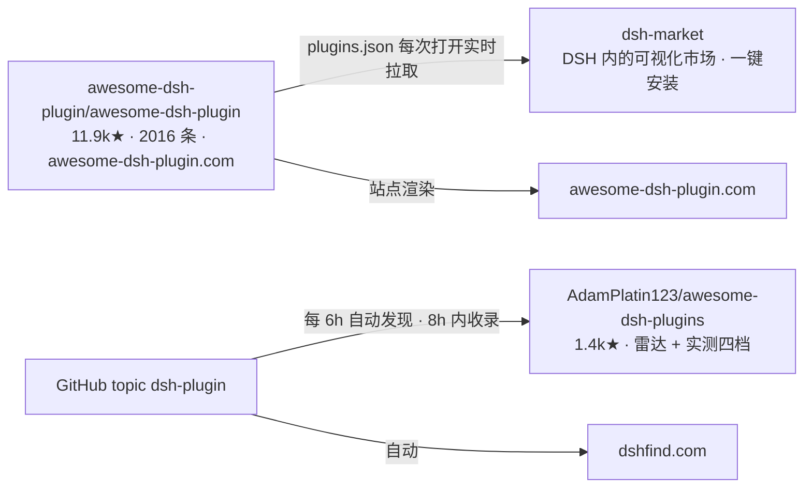

# 怎么把 dsh-swarmdrop 送进 dsh 的插件索引

写于 2026-08-24，对着 dsh `0.1.0-rc.8` 的仓库 README、各索引仓的 contributing 与它们线上
的 `plugins.json` 逐条核实过。**结论先写在最前面，因为它和「官方索引」这个说法不太一样。**

> **已办** 2026-08-24：
> - PR → [awesome-dsh-plugin#2943](https://github.com/awesome-dsh-plugin/awesome-dsh-plugin/pull/2943)（Submission gate 与 check 两项 CI 均通过，待人工评审）
> - Discussion → [deepseek-harness#4279](https://github.com/deepseek-ai/deepseek-harness/discussions/4279)（Show Your Plugins!）
> - 仓库元数据 → topics 补到 6 个（`cordis-plugin` `deepseek-harness` `dsh` `dsh-plugin` `file-transfer` `p2p`），homepage 指向 npm
> - 待观察：AdamPlatin123 雷达与 dsh-market 是否如期收录（分别 8h / PR 合并后约一天）

## 结论：官方没有索引

`deepseek-ai/deepseek-harness` 的 README 只有 "Community and support" 一段，给出三个入口，
没有 registry、没有市场、没有官方收录仓：

| 官方入口 | 是什么 | 我们的状态 |
|---|---|---|
| GitHub topic [`dsh-plugin`](https://github.com/topics/dsh-plugin) | README 里唯一一条「for discoverability」的建议 | ✅ 已加 |
| Discussions 的 **"Show Your Plugins!"** 分类 | 官方开的展示区（"Show off something you've made"） | ❌ 未发 |
| [Discord](https://discord.gg/Ycq5dCaS4) | 社区群 | — |

`docs/user/develop/basic/publish.md` 通篇只讲打包与安装（bundle / profile / npm / tarball /
`github:` 安装的 `allowBuilds` 坑），**没有任何一节讲「发布之后去哪里登记」**。仓里的
`packages/host/plugin-inventory` 与 `packages/client/ui-settings-plugin-inventory` 都是
「当前 profile 已加载插件的只读投影」，是设置页里的插件列表，与分发索引无关——别被名字骗了。

所以「加进官方索引」这件事本身不存在。真正要做的是下面这条社区链路。

## 社区侧：一个中心，其余都从它取数



四个索引，只有一个需要主动提交：

1. **`awesome-dsh-plugin/awesome-dsh-plugin`**（11.9k★）—— 唯一需要提 PR 的，也是唯一重要的。
   它是 **dsh-market 的唯一数据源**，而且 dsh-market 的安装白名单**只认这个列表**
   （「只允许安装 awesome-dsh-plugin 精选列表内的来源，其它一律拒绝」）。
   不在这个列表里 = 用户无法从 DSH 的插件市场里搜到、更装不了。
2. **`dsh-market/dsh-market`**（2k★）—— **不要往这里提**。它的 README 写死了：
   「这个仓库是市场应用本身，不是插件目录……请去那边提 PR，通常一天内生效。」
3. **`AdamPlatin123/awesome-dsh-plugins`**（1.4k★）—— 全自动：靠 `dsh-plugin` topic 发现，
   每 6 小时扫一轮，「加 topic → 8h 自动收录」。**我们已有 topic 但截至今天还没被扫到**
   （仓库 8-21 才建、2★，可能排在发现队列后面）。无需动作，等即可；也可按它的 PR 模板登记。
4. **dshfind.com** —— 已经收了，badge 拉得出来（`dsh-swarmdrop — ★ 2`）。无需动作。

## 我们目前的达标核对

`awesome-dsh-plugin/contributing.md` 的硬性要求，逐条核对本仓（2026-08-24）：

| 要求 | 判据 | 状态 |
|---|---|---|
| `package.json` 声明 `dsh.bundle` | 最常见的被拒原因是只声明了 `dsh.client` | ✅ `dsh.bundle.patch = ./cordis.patch.yml` |
| 仓库根有 `cordis.patch.yml` | | ✅ |
| 仓库创建满 1 天 | CI 自动查 | ✅ 8-21 建，3 天 |
| 提交数 ≥ 10 | CI 自动查 | ✅ 36 |
| 真实可用代码，非占位 | 人工看 | ✅ |
| 加 `dsh-plugin` topic | | ✅ |
| 描述不带营销词、且**必须属实** | 人工核对代码；夸大是主要打回原因 | ⚠️ 见下 |
| 活跃维护 | 定期扫描，停更会被移除 | ✅ |
| （推荐）发布到 npm | 免用户做 `allowBuilds` 构建授权 | ✅ `dsh-swarmdrop@0.6.0` |
| （推荐）官方包用 `peerDependencies` | | ✅ |
| （推荐）peer 范围要带显式 prerelease 分支 | 否则静默排除 harness 的所有 rc 构建 | ✅ `^0.1.0-rc.6` 的比较符就落在 `0.1.0` 元组上并带 rc 标签，能匹配 `0.1.0-rc.8` |

唯一需要留神的是**「描述必须属实」**：维护者会拿描述去核对代码，「写 46 个工具就应该真有
46 个」。我们的 README 没有营销词，但它写得很长且陈述很具体（QR 由 swarmdrop 自己渲染、
配对台席在按 Cancel 前一直有人值守、单实例仲裁……），提交的那一行描述**别去概括这些**，
只说通道本身，把细节留在 README 里。

另一件维护者一定会看到的事：`optionalDependencies` 里的 `swarmdrop ^0.9.0` ——
这个插件靠 SwarmDrop CLI 承担传输。README 第一屏就说明了，不用额外解释，但心里有数。

## 要做的三件事

### 1. 给 awesome-dsh-plugin 提 PR（唯一必需）✅

加**一个文件** `data/plugins/swarm-apps__dsh-swarmdrop.yml`，然后重新生成两个 README 一起提交：

```yaml
url: https://github.com/swarm-apps/dsh-swarmdrop
name: swarm-apps/dsh-swarmdrop
category: remote
description:
  en: 'Device channel between your DSH agent and your own phone: it pushes files it just produced, and you @-reference what your phone sent back, over end-to-end encrypted P2P with no account and no public IP.'
  zh: '把 DSH agent 和你自己的手机连成一条设备通道：agent 把刚产出的文件直接推过去，手机传回来的东西可以在输入框里 @ 引用；端到端加密的 P2P，不需要账号，也不需要公网 IP。'
```

⚠️ **两条描述都必须加引号**——里面含 `: `（英文冒号加空格），不加引号 YAML 会把它解析成
嵌套键，这是 contributing 里单独拎出来警告的一条。

```sh
npm ci
node scripts/generate-readme.mjs   # README.md 与 README.zh.md 是生成的，别手改
```

**只改自己这一条。** contributing 里说手工编辑 README 是事故的常见起因（列表增长导致行号
移位，改动落到邻居身上），CI 现在会列出 PR 动过的每一个既有条目以便被追问。

`category` 选 `remote`（Remote & Mobile）。那一类现在装的多是「从手机远程操作 DSH」，方向
和我们相反，但同类里已经有 `baixianger/dsh-weave`（Iroh mesh）与
`liguobao/deepseek-harness-remote`（跨设备 E2E 通道）这种「设备间链路」条目。备选是 `tools`
（它确实给 agent 装了 `swarmdrop_send_files`）。**不必纠结**——contributing 明写「不会有人
因为分类被打回，维护者觉得别的更贴切会直接改」。

合并后站点与 dsh-market 一般一天内生效（市场每次打开实时拉 `plugins.json`，不做本地兜底）。

### 2. 发一条官方 Discussions ✅

`deepseek-ai/deepseek-harness` → Discussions → **"Show Your Plugins!"**（997 帖），官方唯一的展示区。

⚠️ `dev-notes/dsh-discussion-draft.md` **不是**这个帖子的草稿——那是 8-21 发到 General 的
session event bug 报告（#3802），两回事。展示帖是另写的。

该分类有很成型的社区惯例，照着走即可：标题 `DSH｜插件名｜一句话功能`，正文以
「非官方项目，由社区成员独立开发和维护，与 DeepSeek 官方无关」的引用块开头，然后是
项目地址 / 项目介绍 / 安装 / 状态。中文帖是主流。

### 3. 补 GitHub 仓库元数据 ✅

现在 `topics` 只有 `dsh-plugin` 一个，`homepage` 是空的。npm 的 `keywords` 反而更全。
自动雷达（AdamPlatin123、dshfind）是靠 `topic ×2 + keyword ×3` 多路发现的，多一个 topic
就多一条被扫到的路径：

```sh
gh repo edit swarm-apps/dsh-swarmdrop \
  --add-topic deepseek-harness --add-topic dsh --add-topic cordis-plugin \
  --add-topic p2p --add-topic file-transfer \
  --homepage https://www.npmjs.com/package/dsh-swarmdrop
```

## 提交时才发现的两件事

- **PR 模板还推荐 `data/screenshots.json`**（contributing 正文里那条容易漏看）：登记后插件在
  市场里会像 App Store 一样展示截图；没登记的则在打开安装弹窗时才从 README 现抽。
  本仓一张图都没有，所以这次跳过了——补图是最划算的一次后续改进。
- **安装只需一条命令，别写成两条。** `swarmdrop` 二进制作为 `optionalDependency` 一并带上，
  `dsh plugin add dsh-swarmdrop` 即可用；`PATH` 上自装的优先（数据目录按用户划分、同时只有
  一个进程持有节点、本地通道无版本协商，二者收敛到同一个二进制才不会出现「自己的 swarmdrop
  连不上守护进程」）。第一版 PR 正文写得像「必须自己装 CLI」，发现后已改。

## 顺带记下的事实

- awesome-dsh-plugin 的分类是 21 个固定 key（`ui usage theme model identity session memory
  tools browser vision voice docs skill workflow git notify dev security remote market fun`），
  但**这组取值不固定**：一类长大了就拆（`security` / `browser` / `git` / `docs` / `remote` /
  `voice` 都是从 `tools` / `ui` / `dev` 拆出来的）。
- monorepo 子包收录方式：`url` 指向子目录，`name` 写 `owner/repo#subname`，文件名是
  `owner__repo--packages-my-plugin.yml`。本仓是单包，用不上。
- 不发 npm 的插件可以用可选的 `tarball:` 字段指向 GitHub Release 的 `.tgz`，市场会优先展示它
  而不是源码构建命令。我们发了 npm，用不上。
- 收录不是永久的：停止维护、有恶意行为、有明显缺陷的条目会被移除；两个插件做同一件事时
  「先来者保留位置，但规则不是先来后到，是谁更好」。
